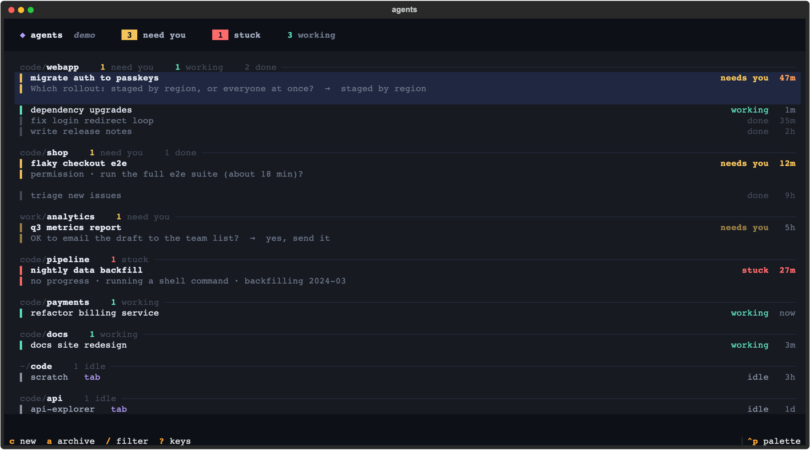

# agents-board

**One screen for every Claude Code session on your machine.** If you run Claude Code in
several repos at once (a few terminal tabs, some background agents) you lose track of which
one is waiting on you. agents-board lists them all, across every folder, sorted by what
needs you first, with a live timer showing how long each has been waiting.



## Install

In any Claude Code terminal session:

```
/plugin install agents-board --marketplace DecentMakeover/agents-board
```

Answer `y` to add the marketplace and pick the user scope. Then type `/board`.

## Use

- **`/board`** opens the full-screen board. In [cmux](https://cmux.dev) it opens in its own tab
  ("◆ agents board") or switches to it if it is already open. Without cmux, `/board` prints the
  one-line command to run it in any terminal, and shows the compact pane meanwhile.
- **`/board pane`** shows a compact version beside the chat; `f` there opens the full screen.
- **Try it with made-up sessions:** `uv run --script <plugin folder>/tui/board.py --demo`.

Keys on the full-screen board:

| Key | Does |
| --- | --- |
| `↑` `↓` / `j` `k` | move between sessions |
| `⏎` / click | open that session in a column beside the board and type into it (see below) |
| `space` | peek: open it in a column but stay on the board |
| `l` | hold / release the column a session is in: a held column is never replaced |
| `x` | close the session columns (the sessions keep running) |
| `i` | show the info panel: full question, suggested reply, original ask (remembered) |
| `g` | group by folder instead of by status (remembered) |
| `c` | start a new session in the selected session's folder, opened beside the board |
| `/` | filter by name, folder or question; `esc` clears |
| `a` / `z` | archive the selected session / undo the last archive (see below) |
| `f` | pin / unpin: keep a session in the Pinned section at the top |
| `h` / `u` | hide a session until its state changes / unhide all |
| `p` | show parked sessions |
| `d` | show every finished session, not just the latest 8 |
| `n` | alerts on/off |
| `r` / `q` | refresh now / quit |

**Session columns.** When the board runs in cmux, `⏎` opens the selected background session in a
column beside the board (`claude attach <id>`), ready for your reply. A second session opens a second
column: board | session | session, the board at about a third. A third session replaces whichever
column you used least recently, so the two you are working with stay up; a session already open is
just focused. `space` does the same without leaving the board, `x` closes the columns. `l` holds the column a
session is in (opening it first if needed): other sessions then only use the other column, so one
task can stay in view while you work through the rest; `l` on it again releases it. Rows open in a
column are tagged ◨ open, the held one ◨ held. Closing or
replacing a column only detaches: the session keeps running. A session marked *asleep* (its process
has exited) resumes when attached.

Interactive sessions (the ones marked `tab`) open in a column too: their own cmux tab is *moved* into
the column (a session can't run in two places), and when the column is replaced, released or closed
the tab goes back to its own workspace, still running. Without cmux, the board tells you the
`claude attach <id>` to run.

**By folder.** `g` regroups the board by folder: each folder gets a header with its counts
(● needs you, ◆ working, ◇ idle, ✓ done), folders that need you come first, and the sessions inside
stay sorted by urgency. `g` again goes back to grouping by status.

**New session here.** `c` starts a session in the folder of the selected session, straight away: an
idle background session (`claude --bg`) that opens beside the board with the cursor in it, so you
type its first prompt there. It shows on the board like any other session, and closing or replacing
its column never ends it. A folder Claude Code doesn't trust yet answers with its trust message: run
`claude` there once.

**Pinned.** `f` pins the selected session: it moves into a ★ Pinned section at the top of the
board, in folder and status view alike, with its folder named on the row, and keeps its live state
and timer there. Pins are kept by session id in `~/.claude/agents-board/pins.json`, so they survive
restarts and resumes, and a pinned session stays listed even once it is finished or parked. `f` again
unpins it; archiving it drops the pin.

**Archive.** `a` archives the selected session: it leaves the board at once, and for 8 seconds `z`
takes it back untouched (still running, same state). After that it is archived for real: its
transcript (and session files) are copied to `~/.claude/session-archive/<sessionId>/`, safe from the
30-day transcript cleanup, and the session is removed from `claude agents`; `z` still restores the most
recent one (idle, same id and name, its pin back). A background session that is done, failed, stopped
or waiting for input can be archived; a running process is stopped first. The format matches the
session-archive mod, so `/unarchive <id>` there works too. Archives still waiting when the board
closes are carried out first.

**Alerts.** When a session newly needs you or looks stuck, the board shows a toast, rings the
terminal bell and, in cmux, sends a cmux notification.

## How sessions are sorted

| Group | A session lands here when | Its timer counts from |
| --- | --- | --- |
| **Needs you** | a permission or question prompt is up, or a background session is `blocked` (waiting for input) or `failed` | when it started waiting |
| **Stuck** | it is working, has no background task in flight, and has written nothing for 15 minutes; or its process died mid-task | its last activity |
| **Working** | it is active, or waiting on a background task of its own (a Monitor, a long shell command) | its last activity |
| **Idle at prompt** | an interactive session sitting at its prompt | when it went idle |
| **Done** | it finished in the last 2 days | when it finished |
| **Parked** | blocked, failed or done, not running, and older than 2 days (hidden; `p` shows them) | — |

Within Needs you and Stuck, running sessions come first, then the longest-waiting.

Every row is one line in the same type, whatever its state: the name, then the state in its colour
(**needs you** amber, **stuck** / **failed** red, **working** green, **idle** grey, **done** blue) and
a one-unit age (now · 12m · 5h · 3d). The row under the cursor also shows what it asks or is doing.
Each folder starts with a tinted header band (name and counts) and a rule, with space above it. A
session that needs you but whose process has exited is drawn in a softer amber. The footer lists the
everyday keys; `?` lists them all.

## Requirements

- Claude Code **2.1.325 or later** (it is a mod: a plugin of function hooks).
- [uv](https://docs.astral.sh/uv/) for the full-screen board. It runs `tui/board.py`, a
  [Textual](https://textual.textualize.io) app, through `uv run --script`, which fetches Textual
  into uv's cache the first time. The compact pane needs nothing extra.
- Optional: [cmux](https://cmux.dev) on macOS, for the one-key jump and notifications.

## How it works, and a caveat

Every 5 seconds (10 for the pane, and only while it is open) it reads:

- `claude agents --json --all`: every session and background job, finished ones included, with its state;
- `~/.claude/jobs/<id>/state.json`: what a background job is asking, its suggested reply,
  whether it has background tasks in flight, and when it last changed;
- `~/.claude/sessions/<pid>.json` and the transcript's modification time: when a session last did
  anything, which is what tells *stuck* from *busy*.

It makes no model calls and sends nothing anywhere. Hidden rows and alert de-duplication are kept
in `~/.claude/agents-board/`.

**Caveat:** those files are Claude Code's internal state, not a public API. A Claude Code update
can change them and break the sorting until this is updated. Issues and PRs are welcome.

## Develop

```
claude plugin validate .      # what the engine will load
claude plugin test .          # tests/*.test.tsx against the engine
uv run --script tui/board.py --demo
uv run --script tui/board.py --selftest   # draws both views headlessly; exit 0 = good
```

A running board restarts itself into a newer `board.py` only after that file passes `--selftest`, so a
broken edit never takes the board down.

The sorting rules live twice, kept in step: `hooks/classify.ts` (the mod) and `classify()` in
`tui/board.py` (the full-screen board).

## License

MIT
